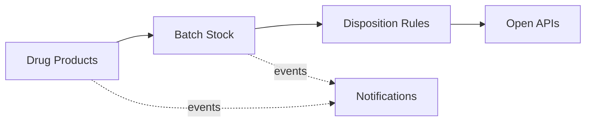

# Domain Model and Bounded Contexts

Ubiquitous language and context design (view VP-4). Domain-standard concepts are mapped
normatively in `../domain/domain-standards.md` (CR-5).

## Ubiquitous language (selected terms)

| Term | Meaning |
|---|---|
| **Drug product** | A registered tablet, capsule, injectable or topical product (ATC-coded) |
| **Batch stock** | A batch's guarded available-units account |
| **Batch release** | One release of units from a batch (QA release, distribution, sample) |
| **Disposition rule** | A decision rule binding a product type to batch-size and deviation envelopes |
| **Serial package** | A serialized bottle, blister, vial or box format |
| **Deviation risk score** | A transparent 0-100 batch risk score |

## Bounded contexts and invariants

### Drug Products — `drug-product-service`
Drug product registry (ATC-coded). Lifecycle: `REGISTERED` → transitions
approve, withdraw. No patient data exists in this core, by design. Batch and product data is regulated operational data handled under GxP-style audit discipline (attributable, contemporaneous, append-only); all data is synthetic.

### Batch Stock — `batch-stock-service`
Guarded batch stock accounts and the releases against them. **Invariant (ADR-0004): units released from a batch never exceed the batch's available stock — a release that would overrun it is rejected (422) and records nothing; batch disposition is always evidenced.** Consumption records are
append-only evidence; a rejected operation records nothing.

### Disposition Rules — `disposition-rules-service`
Decision rules binding product types to batch-size and deviation envelopes. Only ACTIVE rules decide; evaluation order is by priority; every decision
is ALLOWED / DEGRADED / DENIED with the matched rule and a human-readable reason.

### Serial Packages — `serial-package-service`
Serialized package format catalogue.

### Notifications — `notification-service`
Delivery trail for audit; recipients are never logged.

## Context map

